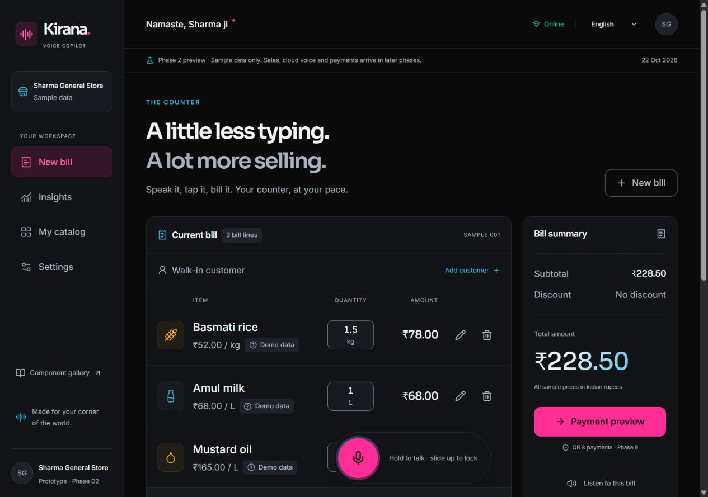

# Kirana Voice Copilot

A voice-first counter companion for India's neighbourhood grocery stores.

**Build scope: Phases 1–5 prototypes, plus the public website.** This repository contains the monorepo foundation and an interactive, accessible design prototype. Sample bills and insights are explicitly illustrative. Merchant accounts, onboarding, catalog search and store-specific items are implemented. Catalog names remain machine drafts awaiting native review, and default prices are synthetic. Layered pricing and private history are included. Cloud speech (6), parsing (7), persisted billing (8), payments (9), analytics (10), recommendations (11–13), and offline sync (14) are separate milestones.

## Architecture

```mermaid
flowchart LR
  PWA[React PWA] --> API[Express /api/v1]
  API --> Mongo[(MongoDB replica set)]
  API --> Reco[Python FastAPI]
  API -. Phase 6 .-> Sarvam[Sarvam speech]
  API -. Phase 9 .-> Paytm[Paytm QR]
  API -. Phase 9 Socket.IO .-> PWA
  Reco -. Future read-only access .-> Mongo
```

See [the build ledger](docs/progress.md), [architecture](docs/architecture.md), and [contribution guide](CONTRIBUTING.md).

The public website adds Home (`/`), Our Story & Mission (`/about`), How It Works (`/how-it-works`), and the full Roadmap (`/roadmap`). The public merchant sample is at `/demo/bill`; `/bill` is the authenticated workspace. See [the public-site handoff](docs/public-website.md).



The [Phase 2 handoff](docs/phase-02-handoff.md) records delivered behavior, acceptance evidence and physical-device checks still needed. The two phase checkpoints are tagged `phase-01-done` and `phase-02-done`.

## Start locally (PowerShell)

```powershell
npm ci
Copy-Item apps/server/.env.example apps/server/.env
Copy-Item apps/client/.env.example apps/client/.env
Copy-Item services/reco/.env.example services/reco/.env
npm run dev:all
```

Start Docker Desktop first. Open http://localhost:5173 for the public website or http://localhost:5173/demo/bill for the merchant sample. Compose serves a production build, so `/dev/ui` is intentionally absent. For the development gallery and hot reload, stop the Compose client (`docker compose -f infra/docker-compose.yml stop client`) and run `npm run dev -w @kirana/client` instead.

Without containers, run MongoDB as a replica set, then:

```powershell
python -m venv .venv
.venv/Scripts/python -m pip install -r services/reco/requirements-dev.txt
$env:PYTHON = (Resolve-Path .venv/Scripts/python.exe).Path
npm run dev
```

The Python launcher reads `services/reco/.env`; the API reads `apps/server/.env`. The client prototype can also run independently with `npm run dev -w @kirana/client`.

## Verify

```powershell
npm run lint
npm test
npm run build
npm run format:check
python -m pytest services/reco/tests
python -m ruff check services/reco
```

Use your virtual environment's interpreter for Python checks. Health URLs: API `/healthz`, `/readyz` at port 3001; reco `/healthz`, `/readyz` at port 8000. Reco `/v1` requires `x-api-key`. Readiness returns 503 when Mongo is unreachable; process liveness stays 200.

Deployment preparation and every required variable/secret are in [docs/deploy.md](docs/deploy.md). Live SMS needs a vendor adapter and credentials. Cloud speech and real payments remain deferred according to the plan.

## Merchant accounts (Phase 3)

Open `/login` to set up a store. `/bill`, `/catalog`, `/insights`, `/settings`, and `/customers` require a session; unfinished accounts resume `/onboarding`. The sample UI remains public under `/demo/bill` and sibling demo routes.

See [the Phase 3 handoff](docs/phase-03-handoff.md) for development OTP configuration, the optional disposable database, security choices, acceptance evidence, and current integration limits.

## Catalog and units (Phase 4)

Run `npm run seed` against your configured MongoDB, restart the API, and open `/catalog` after onboarding. The 758-item draft supports 11 script/name fields, aliases, private prices and custom items, favourites, hidden items, exact quantity previews, and cached read-only search. `npm run gen:catalog` regenerates the draft source; `npm run bench:catalog` checks search performance.

See [the Phase 4 handoff](docs/phase-04-handoff.md) for API and future billing contracts, verification evidence, and outstanding native-language review. Checkpoints are tagged `phase-03-done` and `phase-04-done`. Phase 5 adds a real draft bill and layered prices; sales are not persisted yet.

## Pricing (Phase 5)

Run `npm run market:ingest` against the API database to prepare the deterministic demo feed. Restart the API for immediate cache refresh. Open `/bill` to add actual catalog items, edit a price for one draft, or save a private unit price with history and Undo. See [pricing contracts and feed assumptions](docs/pricing.md) and [the Phase 5 handoff](docs/phase-05-handoff.md). Live Agmarknet needs credentials, metadata/licence verification and explicitly approved mappings.
