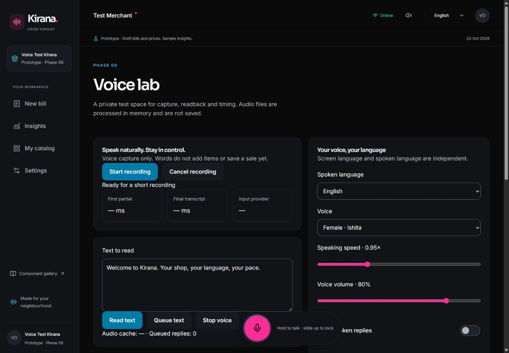

# Phase 6 — voice capture and readback

Re-read the plan's global preamble and the full Phase 6 master prompt/acceptance pages before implementation. Phase 5 was committed and pushed first (`4c5c340`, `phase-05-done`); its [CI run passed](https://github.com/Utkarsh2294/Kirana-Voice-Copilot/actions/runs/39909836125). This checkpoint implements only the voice platform. See [ADR-008](adr/008-voice-wire-protocols-and-limits.md) for current protocol differences, privacy, cost assumptions and limits.

## Delivered

- Server-only Sarvam streaming/REST STT and short/long TTS adapters, explicitly configured Bhashini fallback, strict language/voice/pace schemas, a 23-input/11-output capability matrix, and device-dependent browser speech fallback.
- Gesture-resumed mono capture, self-hosted VAD, a 16 kHz PCM16 worklet, 200 ms frames, speech gating, input meter, tap/hold/slide-lock controls, fifteen-second limit, cancellation and disconnect cleanup.
- Authenticated, origin-checked `/ws/voice` with single-use tickets, partial/final transcript messages, language hints/auto-detection, bounded REST fallback, timing metrics and resource limits.
- `useSpeak`: press-time dynamic builders, normalized text, sentence splitting, queue, interruption, stop and microphone barge-in. Listen controls show loading/playing/error and stop playback. Bill readback uses actual draft lines, quantities, amounts and total in the selected spoken language; Insights reads explicitly labelled sample KPIs; onboarding reads current instructions. A screen registry supplies the global listen control.
- Separate spoken/UI language preferences, male/female voice, calm default pace, volume, mute and explicit account persistence. Language selection prewarms a localized common phrase when a cloud provider is configured. Auto-detection offers a reply-language change; transcripts do not modify a bill.
- Private GridFS and device audio caches; bounded daily/minute usage, approximate cost reservations, timing and per-draft metrics; optional redacted sample retention off by default.
- Authenticated development-only `/dev/voice` with capture, partial/final text, file regression, timing, arbitrary readback, queue and cache status. The lab is excluded from production. Public pages describe the implementation and its configuration requirements honestly.

## Run

Keep the existing local/Compose setup. In **server** `.env`, set `SARVAM_API_KEY` and a positive integer `DAILY_VOICE_BUDGET` in paise, then restart the API. Example: `DAILY_VOICE_BUDGET=500` caps the application's daily estimate at ₹5 per merchant. The committed example has no key and a zero budget. Never add vendor keys to `VITE_` configuration or source control. Bhashini remains disabled unless a valid callback, authentication and per-language service IDs are supplied.

Open `/settings` after onboarding. Choose spoken language independently of screen language, preview, and save. In `/bill`, the microphone captures speech and the listen control reads the current draft. Recording requires HTTPS or localhost and permission granted by the merchant. Missing permissions, hardware, language voices, credentials, network or budget leave typed/tap interaction usable and surface a readable error/fallback notice. Browser recognition may require its own online service.

For `/dev/voice`, use the Vite development server. Upload the supplied synthetic fixtures or your own consented recording shorter than fifteen seconds and smaller than 5 MB. The lab shows the actual provider transcript for manual golden comparison. It never stores the uploaded recording.

```powershell
npm run lint
npm test
npm run format:check
npm run build
node scripts/check-client-build.js
npm audit --audit-level=high
```

GitHub CI additionally installs Chromium and runs `npx playwright test` against an isolated Mongo replica set and controlled speech providers. Chromium's microphone is replaced with the committed synthetic WAV fixture. No room microphone, SMS, real speech key or paid service is used. Trace, screenshot and HTML report are uploaded as `voice-browser-results`. The test covers real microphone APIs/worklet/VAD/PCM/gateway, final transcript, playback, second-play device cache, interruption, file regression and key isolation. Local browser checks use the same synthetic file flow through the app UI.

## API contracts

All REST routes are under `/api/v1`, require merchant authentication and use the existing CSRF client header for writes.

| Route                     | Purpose                                                                                      |
| ------------------------- | -------------------------------------------------------------------------------------------- |
| GET `/voice/capabilities` | Matrix plus configured provider availability, independent of browser support                 |
| POST `/voice/token`       | `{lang?: code or auto, clientBillId?: UUID}` → single-use ticket, expiry and recording cap   |
| WS `/ws/voice`            | Binary mono PCM16/16 kHz frames, then `{type: finish}`; ready/partial/final/error messages   |
| POST `/voice/tts`         | `{text,lang,voice?,pace?,format?,clientBillId?}` → audio plus private cache/provider headers |
| POST `/voice/cache-hit`   | Bounded device-hit counters validated against the owner's server cache key                   |
| GET `/voice/usage`        | Own daily operational aggregates and configured estimate cap                                 |

Saved voice preferences use the existing merchant language and settings endpoints. Bill usage metrics use the draft UUID; no sale record is introduced.

## Acceptance and limits

- [x] Shared PCM/resampling, language mapping, sentence limits and provider ordering checks.
- [x] Actual Mongo/HTTP/WebSocket tests cover private output caches, all eleven TTS requests, long-stream selection, single-use/replay tickets, origin/ownership, disconnect cleanup, REST fallback, input size, fallback credentials, usage limits and opt-in redaction.
- [x] Provider wire tests check current REST fields, realtime Odia spelling, manual stream events, MP3 sentence streaming and configured Bhashini payloads.
- [x] Client tests cover press-time readback values, queue clearing and barge-in before microphone setup.
- [x] Browser file decoding + self-hosted VAD + authenticated PCM gateway + controlled final transcript; first playback misses and second uses device cache.
- [x] Automated fake-microphone regression is wired into GitHub CI; the pushed checkpoint's run result is reported in the delivery message. It uses synthetic audio and controlled providers.
- [ ] Live Hindi/Tamil/English ASR accuracy, partial/final latency and auto-detection: no Sarvam key is configured in this workspace. Controlled-provider results do not establish accuracy.
- [ ] Live pronunciation/voice quality in all eleven languages, long-output latency and Bhashini service suitability require credentials and human review. Spoken templates and catalog names are draft translations pending native-speaker review.
- [ ] Android/iOS hardware, Safari user-gesture playback, low-memory phones, noisy shops and real screen-reader/device checks remain pilot gates. The self-hosted runtime/model download is substantial on first use. Progressive long-response browser streaming is not implemented; the server buffers bounded vendor MP3 output before playback.

The prototype stops before Phase 7. Parsing, saved sales, payment collection, real analytics and advice remain later phases. No production deployment or live-provider acceptance is claimed.

Local verification: 95 tests passed; the final focused voice/auth regression passed 19 tests. Lint, formatting, production build and audit passed with zero reported vulnerabilities. The bill-route check passed at 179.9 KiB (sample) and 179.7 KiB (real draft), including first-run and gesture chunks; VAD/model assets remain outside that initial load. The desktop screenshot uses a disposable merchant and controlled speech provider, not a live Sarvam acceptance result.



Hindi mobile verification at a 360 px viewport showed no horizontal overflow (345 px content width after the scrollbar). See [mobile evidence](screenshots/phase-06-voice-hindi-mobile.png). Both dark and day controls use the shared surface/text tokens.
